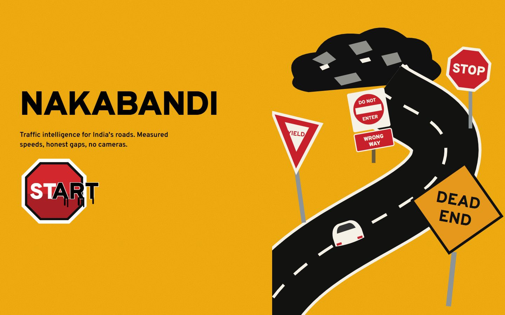
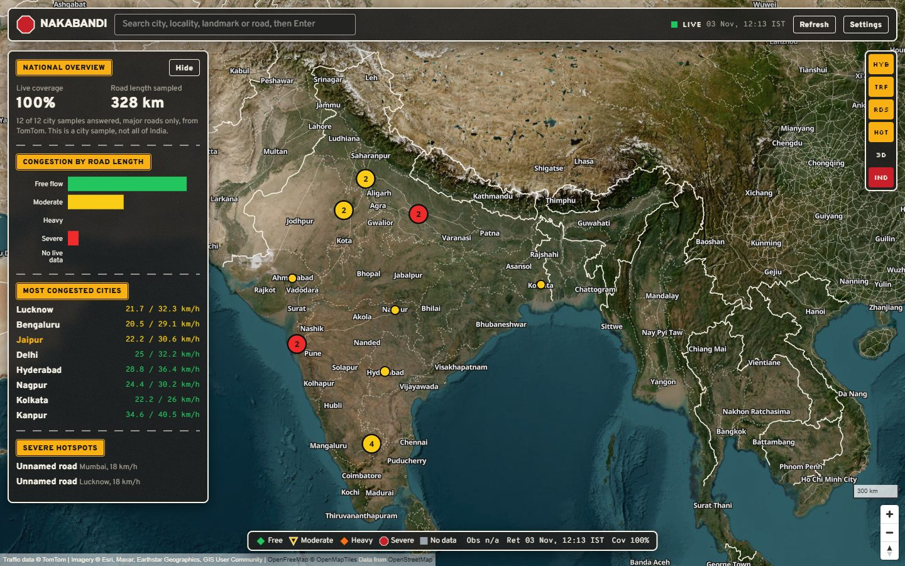
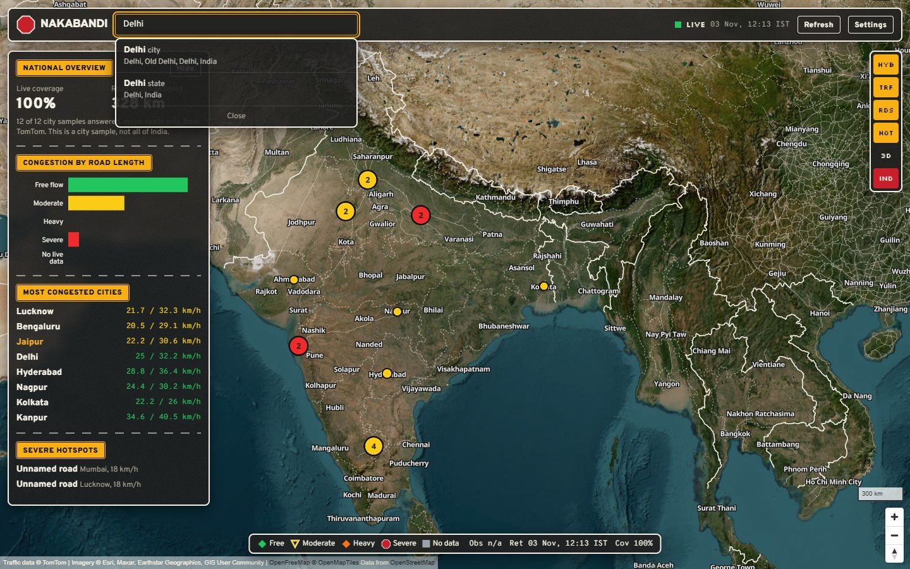
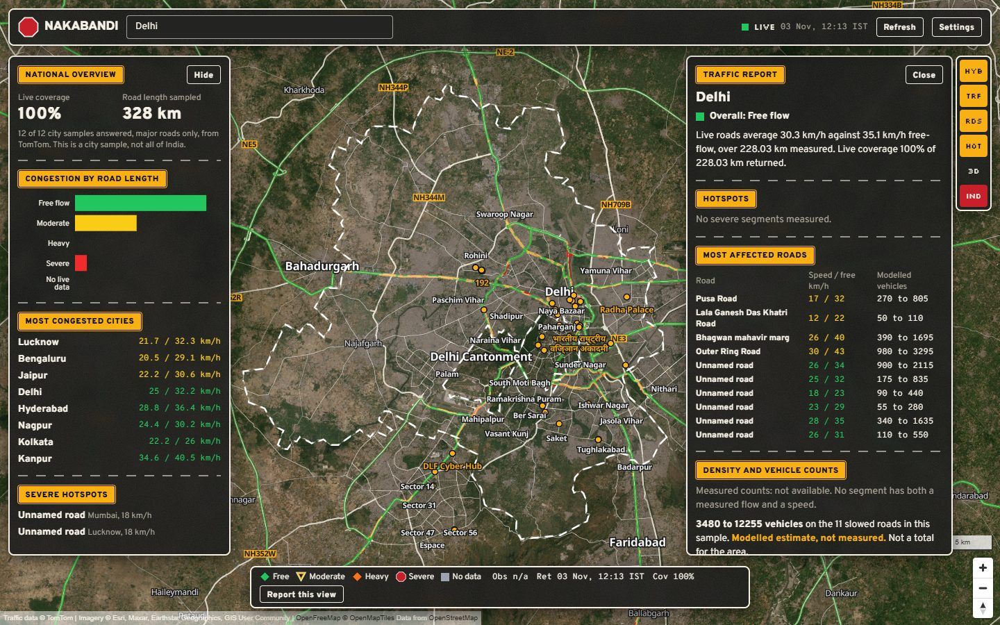
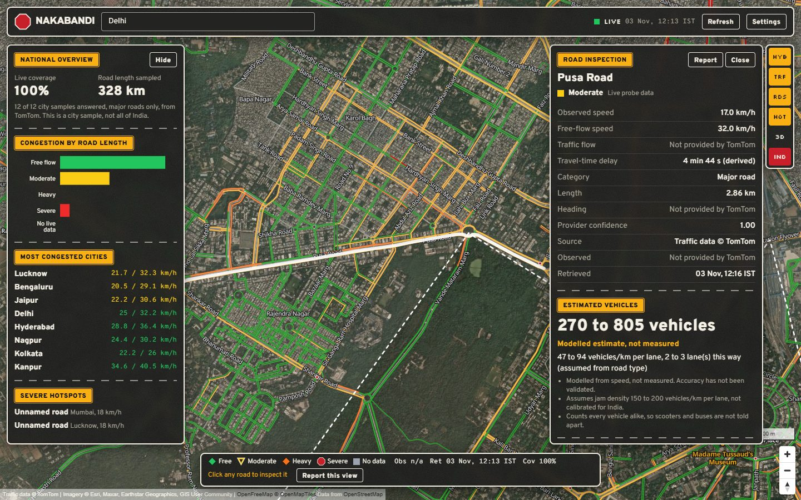
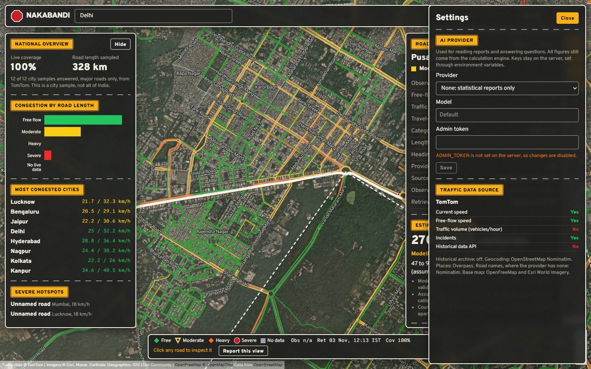
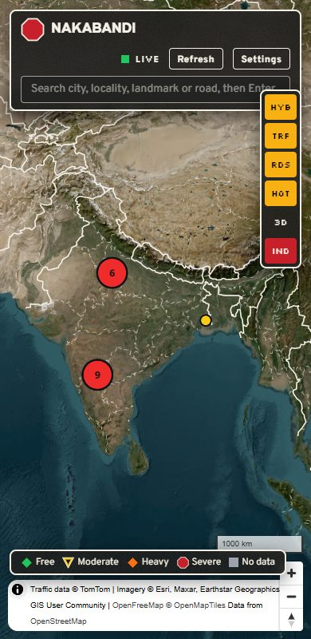
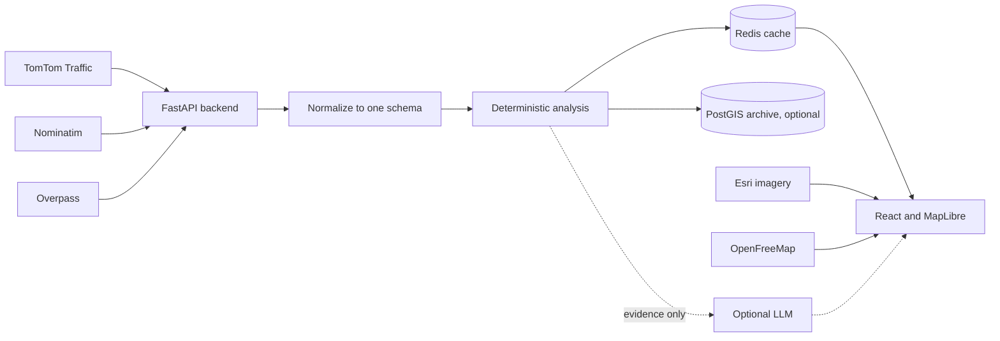

<p align="center">
  
</p>

<p align="center"><strong>Camera-free traffic intelligence for India.</strong><br />Live road speeds on a satellite map, with every number traced to its source.</p>

## Stack

<table>
  <tr>
    <td valign="top" width="50%">
      <strong>Frontend</strong><br /><br />
      
      
      
      
      
      
    </td>
    <td valign="top" width="50%">
      <strong>Backend</strong><br /><br />
      
      
      
      
    </td>
  </tr>
  <tr>
    <td valign="top">
      <strong>Data and infrastructure</strong><br /><br />
      
      
      
      
      
    </td>
    <td valign="top">
      <strong>Data services</strong><br /><br />
      
      
      
      
    </td>
  </tr>
  <tr>
    <td valign="top">
      <strong>Testing and quality</strong><br /><br />
      
      
      
      
      
    </td>
    <td valign="top">
      <strong>Optional AI adapters</strong><br /><br />
      
      
      
    </td>
  </tr>
</table>

## About

*Nakabandi* is the Hindi word for a road checkpoint. This one uses no cameras. It reads traffic data from a provider API, draws it on a satellite map of India, and runs the analysis in plain, testable code.

It has one firm rule: a number must never look more certain than it is. Live measurements, historical fallbacks and modelled estimates are kept apart and labelled. If the data is missing, the app says so instead of filling the gap.

## Walkthrough

Captured from the running app on real TomTom traffic, on 3 November 2026.

**1. Start.** The start screen. Press START to open the map.



**2. See India.** Live coverage, congestion by road length, most congested cities and hotspots, from a 12-city sample.



**3. Search.** Type a place and press Enter, then pick a result.



**4. Read the city report.** The map flies to the city, outlines its boundary, marks localities and landmarks, and draws traffic on the roads. The report lists the most affected roads with their speeds and modelled vehicle ranges.



**5. Inspect a road.** Pick a road from the report or click one on the map. This view shows its speeds, delay and a vehicle range labelled as modelled, not measured.



**6. Check the sources.** Settings shows what the traffic provider does and does not supply, and lets an admin choose an optional AI provider.



**7. On a phone.** The overview starts collapsed so the map stays visible.

<p align="center"></p>

## What the app does

### Map
- Opens on all of India, on Esri satellite imagery with OpenStreetMap roads, boundaries and labels.
- Colours roads by live congestion, using TomTom's traffic tiles so the colours sit on the real roads.
- Marks congested spots from a 12-city sample as hotspots. Nearby ones cluster at national zoom.
- Opens in 3D: a tilted globe with real terrain, OpenStreetMap building heights and hotspot columns. Column height shows how slowed the road is, not a vehicle count.
- Supports zoom, pan and rotate.

| Control | Action |
|---|---|
| `HYB` | Labels and boundaries on or off |
| `TRF` | Traffic colours on or off |
| `RDS` | Road network on or off |
| `HOT` | Hotspots on or off |
| `3D` | Switch between the 3D globe view and a flat map |
| `SIM` | Illustrative flow dots, clearly labelled as simulated. Hidden with TomTom, because its road direction is not documented |
| `IND` | Back to the full India view |

### Search
Type a city, state, district, locality, landmark or road and press Enter. The map flies there and outlines the boundary when one exists. City-sized places also load localities, landmarks and traffic signals, and start a report.

### Road inspection
Zoom to city level and click a road to see:
- Current and free-flow speed, travel-time delay, category and length
- Provider confidence, data source and retrieval time
- Incidents reported within about 300 m
- A modelled vehicle range when the road is slowed
- A pin button to compare up to 5 roads

### Traffic reports
A report covers overall condition, severe hotspots, most affected roads, modelled vehicle ranges, incidents, roads without live data, and recommendations that quote the observations behind them. Each one states when it was generated, when the data was retrieved, the provider, the area covered and its limitations.

**Save city card** downloads a square PNG of the report, made for sharing. It shows the +1000 AURA sticker at free flow, GAME OVER at heavy or severe, and no sticker at moderate or without live data. The card keeps the data source, time and "modelled, not measured" label.

### Near me
**Near me** asks for your location, opens your city with its report, and shows your area's traffic card to save. The browser rounds your position to about 1 km before sending it, only to find the city, and it is not stored with your identity. Browsers only allow this on `localhost` or HTTPS.

### Live updates
The app updates itself while its tab is visible, and stops while hidden so it spends no quota.

| What | Updates | Spends |
|---|---|---|
| Clock and "traffic N ago" | Every second | Nothing |
| Map traffic colours | Every 2 minutes, swapped without blanking | About 40 tile calls at 1440 × 900 |
| Open road panel | Every minute | 1 flow call |
| Open report | Checks every minute, new speeds every 15 minutes | Up to 25 flow calls per new reading |
| National overview | Checks every minute, new samples every 3 hours | 48 flow calls per new sample |

If new data fails, the last good data stays on screen and the label changes to STALE. TomTom gives no timestamp for its measurements, so "traffic N ago" is when Nakabandi fetched them, not when they were measured.

### National overview
The left panel shows live coverage, congestion by road length, most congested cities and severe hotspots. It is a sample of 12 cities, not all of India, and it says so.

### AI reading (optional)
Choose OpenAI, Gemini or Ollama in Settings to get written summaries and ask questions about a report or pinned roads. Without one, reports stay purely statistical.

## How the API science works



### Where each piece of data comes from

| Data | Source | Notes |
|---|---|---|
| Road colours on the map | TomTom Raster Flow Tiles | Sent through the backend, so the key never reaches the browser |
| Speed, free-flow speed, travel times, confidence | TomTom Flow Segment Data | One point per call. The nearest road answers |
| Incidents | TomTom Incident Details | Closures first, then by severity |
| Road names, lane tags | OpenStreetMap, via Nominatim reverse | TomTom returns neither |
| Place search | OpenStreetMap, via Nominatim | Runs on Enter, because its policy bans autocomplete |
| Localities, landmarks, signals | OpenStreetMap, via Overpass | Shared service, can be slow or fail |

### From speed to congestion

The ratio of current speed `v` to free-flow speed `vf` sets the level shown in panels and reports:

| `v / vf` | Level |
|---|---|
| 0.75 or more | Free flow |
| 0.50 to 0.75 | Moderate |
| 0.25 to 0.50 | Heavy |
| Below 0.25, or road closed | Severe |
| Confidence below 0.7 | No live data |

TomTom documents confidence only as a 0 to 1 quality score, so the 0.7 cut-off is this project's choice. Map tiles use TomTom's own colour scale, so a road's colour can differ slightly from its panel label.

Area figures are weighted by road length. Average speed is harmonic, `Σ L / Σ (L / v)`, because that matches total travel time.

Travel-time delay is `current travel time − free-flow travel time`.

### Sampling an area

TomTom answers one point per call, so an area is read through a grid, and each point snaps to its nearest road:

- City report: 5 × 5 grid at most, 25 calls, within the central 0.1° × 0.1°, about 11 km across
- National overview: 12 cities × 4 points, 48 calls

These are samples of nearby roads, not every road. Reports say so.

A city's overall level is the worst level reached by at least a quarter of its live road length, counting only road inside the sampled area. An average would hide a jam: in one test, Prayagraj's central roads were 18% congested while a wider box read 100% free. The sample still reads one speed per road, so it can differ from the map, which shows changes along a road. The map flies to the sampled area and marks it with a dashed box.

The vehicle total counts only each road's share inside that box. A single road's own figure covers all of that road.

### Estimating vehicles

TomTom reports no traffic volume, so a true count is not possible from this data. Nakabandi has two separate paths.

**Measured path.** When a provider reports flow `q`, the fundamental relation gives density and a count:

```
q = k × v
k = q / v
N = k × L = (q × L) / v
```

This path is built and tested, but it stays inactive with TomTom because `q` is never available.

**Modelled path.** With only speed, density is inferred from speed-density models:

```
Greenshields:  k = kj × (1 − v / vf)
Underwood:     k = (kj / 2) × ln(vf / v)
Vehicles:      N = k × L × lanes
```

| Symbol | Meaning | Source |
|---|---|---|
| `v`, `vf` | Current and free-flow speed | TomTom |
| `L` | Segment length | Calculated from the road shape with the haversine formula |
| `kj` | Jam density | Assumed: 150 to 200 vehicles/km per lane |
| `lanes` | Lanes per direction | OpenStreetMap `lanes` tag, or assumed from road type |

The range runs from the lowest to the highest result across both models and both `kj` values, capped at the assumed jam density.

**Worked example:** `v` = 22 km/h, `vf` = 31 km/h, `L` = 1 km, 2 lanes.

```
Greenshields:  150 × (1 − 22/31) = 43.5    200 × (1 − 22/31) = 58.1
Underwood:     75 × ln(31/22)    = 25.7    100 × ln(31/22)   = 34.3

Density range: 25.7 to 58.1 vehicles/km per lane
Vehicles:      about 51 to 116, shown as "50 to 120, modelled estimate, not measured"
```

**What the app refuses to do:**

| Situation | Result |
|---|---|
| Speed at 90% of free-flow or more | "Light traffic, count unknown", because both models tend to zero |
| No live data, zero speed or missing inputs | "Cannot estimate" |

**How far to trust it.** Treat the range as a rough scale, not a count:
- It has not been compared with real counts, so its error is unknown.
- `kj` is a general reference value, not calibrated for India.
- Scooters and buses count the same, a poor fit for mixed Indian traffic.
- Each segment is assumed to carry one direction.

### Keeping the data honest

- **One schema:** providers normalize into `RoadSegment`, `TrafficObservation` and `TrafficEstimate`, so one can be swapped without rewriting the app. TomTom is active, and a HERE adapter is included.
- **Failures:** rate limits and server errors retry with backoff. If a provider still fails, the last good data is shown and marked STALE.
- **AI limits:** models receive computed evidence and never produce the figures. Any number in an answer that is not in the evidence is flagged in the UI.
- **Secrets:** keys stay on the server, in `.env`, which git ignores.

### Staying on the free tier

| Action | TomTom calls | Cached for |
|---|---|---|
| National overview | 48 flow | 3 hours |
| City report | Up to 25 flow, 1 incident | 15 minutes |
| Clicking a road | 1 flow, 1 incident | Flow 1 minute while open, incident 15 minutes |
| Map traffic layer | 1 per tile, about 40 per refresh | Not cached, TomTom sends `no-store` |

The API stops calling TomTom for the day at 600 flow, 6000 tile and 75 incident calls. Change this with `FLOW_DAILY_BUDGET`, `TILE_DAILY_BUDGET` and `INCIDENT_DAILY_BUDGET`. The counters reset when the API restarts.

## Run it

Get a free key from [TomTom](https://developer.tomtom.com). Put it in `.env`, never in `.env.example`, because that file is committed.

```bash
cp .env.example .env
docker compose up --build
```

Open http://localhost:8080.

Without Docker, run each part in its own terminal:

```bash
cd backend && python -m venv .venv && .venv/Scripts/pip install -e ".[dev]" && .venv/Scripts/uvicorn app.main:app --port 8000
```

```bash
cd frontend && npm install && npm run dev
```

Open http://localhost:5173.

To turn on the history archive, set `DATABASE_URL` and run `docker compose --profile history up`. It is off by default until you have checked your provider's storage terms. Reports then compare with the same weekday and hour over the past 28 days, once 20 samples exist.

To show your own photo on the start screen and in Settings, save it as `frontend/public/theme/ride.jpg`. That folder is git-ignored.

## Tests

```bash
cd backend && .venv/Scripts/python -m pytest && .venv/Scripts/ruff check app tests
```

```bash
cd frontend && npm run lint && npm test && npm run build
```

The browser test needs the test server and the dev server running. It uses a fixture traffic provider that exists only in `backend/tests`:

```bash
cd backend && .venv/Scripts/python -m tests.e2e_server
```

```bash
cd frontend && npm run dev
```

```bash
cd frontend && npm run e2e
```

`frontend/e2e/live-check.mjs` runs the same kind of flow against the real provider and spends real quota.

## Known limits

- Reports and the national overview are samples, not full coverage.
- Road names come from OpenStreetMap at the road midpoint. They may name a nearby road or find none, and the national hotspot list stays unnamed.
- TomTom gives no observation time, so the app shows retrieval time instead.
- TomTom's flow data flags a whole segment when part of it is closed, without saying which part. If traffic is moving, the app colours it by speed and says "part closed".
- TomTom's traffic colours cover many inner roads in some cities, such as Delhi, and only main roads in others, such as Kareli in Prayagraj. Roads without colours are grey, meaning no data, not empty roads.
- The OpenAI, Gemini and Ollama adapters have not been tested against the real services.
- The PostGIS archive passes its test from Linux containers. Connecting from Windows failed in testing.

## Before a public or commercial launch

- **TomTom:** review the terms, including free-tier commercial use and attribution.
- **Esri imagery:** sources disagree on the licence, so check Esri's terms.
- **Overpass:** commercial use should self-host. Set `OVERPASS_URL`.
- **Boundaries:** they come from OpenStreetMap and are not an official Survey of India depiction.

## Attribution

Traffic data © TomTom. Imagery © Esri, Maxar, Earthstar Geographics and the GIS User Community. Map data © OpenStreetMap contributors. Tiles by OpenFreeMap © OpenMapTiles.
